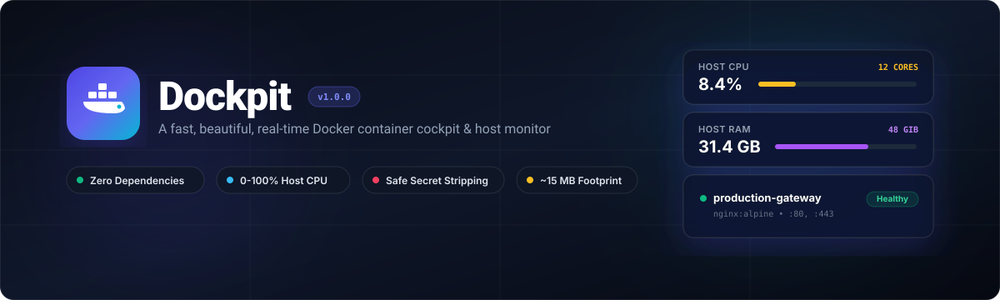

<div align="center">


[](https://github.com/Elounia/dockpit/actions/workflows/ci.yml)
[](LICENSE)
[](pyproject.toml)

A lightweight, read-only dashboard for Docker Compose stacks and Linux hosts.
No third-party Python runtime dependencies. Browser assets are included and work offline.
</div>

## Preview


The preview uses sample data. See the running dashboard for current features.

## Features

- Containers grouped by Compose project or Swarm stack, including stopped containers. Unassigned containers sharing an image repository are grouped automatically; CubeCoders AMP instances appear under AMP.
- Organize stacks with searchable bulk selection, existing or new stack names, and a reset to automatic grouping. Choices persist in this browser; container names keep assignments stable across recreation.
- Host CPU, RAM and storage metrics; Docker CPU totals normalized to host capacity.
- GPU card beside CPU with device details, utilization and VRAM where supported; NVIDIA GPU/VRAM per container. See [GPU setup and driver support](docs/DOCKER.md#gpu-monitoring).
- Cache-adjusted container memory (`Used Memory = max(0, usage - inactive_file)`), per-container limits and network I/O totals.
- Status filters for running, stopped, paused, starting/created, and containers with published ports. Needs attention highlights unhealthy, dead and restarting containers; stopped containers are a neutral category. Sort by CPU or RAM to find resource-heavy workloads.
- CPU/RAM sparklines with up to one hour of in-memory history. History resets on restart.
- Search, sorting and persistent filters/expanded stacks in browser local storage.
- Log snapshots refreshed every three seconds, with pause, search, timestamps, copy and download.
- Container details including restart count, exit code and OOM status. Environment variables and healthcheck log output are excluded from inspection responses.
- Diagnostics, measurement timestamps, stale-data warnings, liveness and readiness endpoints.
- Optional labels for application names, icons, links and hiding containers.

## Quickstart — Linux and Docker Compose

```bash
git clone https://github.com/Elounia/dockpit.git
cd dockpit
export DOCKER_GID="$(stat -c '%g' /var/run/docker.sock)"
docker compose up -d --build
```

Open **http://localhost:8989** on the Docker host. From another machine, use an SSH tunnel, Tailscale Serve or an authenticated reverse proxy; the published port binds to localhost.

```bash
# From your workstation:
ssh -L 8989:127.0.0.1:8989 user@your-server
```

The socket's group ID varies by host. Compose requires `DOCKER_GID` rather than guessing it. Rootless Docker uses a different socket path; see [deployment](docs/DOCKER.md).

### Docker CLI

Build the local image first:

```bash
docker build -t dockpit:local .
docker run -d --name dockpit --restart unless-stopped \
  -p 127.0.0.1:8989:8989 \
  --group-add "$(stat -c '%g' /var/run/docker.sock)" \
  -v /var/run/docker.sock:/var/run/docker.sock:ro \
  -v /proc:/host/proc:ro -v /sys:/host/sys:ro -v /:/host/root:ro \
  --read-only --cap-drop ALL --security-opt no-new-privileges:true \
  --tmpfs /tmp dockpit:local
```

Prebuilt images are published for amd64 and arm64: `ghcr.io/elounia/dockpit:1.1.0`. Run `docker pull ghcr.io/elounia/dockpit:1.1.0` and use that image in place of `dockpit:local` in the command above.

### Standalone Python

```bash
python3 -m dockpit
# Or install into a virtual environment:
python3 -m venv .venv
.venv/bin/pip install .
.venv/bin/dockpit
```

Requires Linux procfs and access to the Docker socket. If the socket is absent, Dockpit uses the Docker CLI. There is no Docker CLI in the provided container image. Python 3.9 remains compatible; CI also tests newer interpreters.

## Security model

Dockpit has **no built-in authentication**. Keep it on a trusted host or behind a VPN/authenticated reverse proxy. The supplied Compose file publishes only on `127.0.0.1`; the container itself listens on `0.0.0.0` internally.

- The HTTP API exposes read operations. **Mounting `docker.sock:ro` does not make Docker API access read-only.** Socket access to a rootful daemon is highly privileged, even when Dockpit runs as UID 1000. Consider a Docker authorization proxy restricting allowed endpoints.
- Host filesystem mounts expose host information to the process. Restrict access to the dashboard and host.
- Inspection excludes `Config.Env`, command arguments and healthcheck output. Logs, mount paths and network information may still contain sensitive data. Log exports retain their original contents.
- External values are escaped before HTML rendering; log contents are rendered as text. A Content Security Policy restricts scripts to local files. Cross-origin API access is not enabled.
- Log responses and reads are bounded to 1 MiB and requests to 500 lines. These limits can truncate a large line or snapshot.

See [SECURITY.md](SECURITY.md) for private vulnerability reporting and [remote access](docs/AUTHELIA_SSO.md) for proxy/VPN deployment.

## Configuration

| Variable | Default | Purpose |
|---|---|---|
| `DOCKPIT_HOST` | `127.0.0.1` natively; `0.0.0.0` in Docker | Listen address |
| `DOCKPIT_PORT` | `8989` | HTTP port |
| `DOCKPIT_DOCKER_SOCKET` | `/var/run/docker.sock` | Unix socket path |
| `DOCKPIT_POLL_INTERVAL` | `2.0` | Seconds between completed polls, range 0.5–3600 |
| `DOCKPIT_PROC_DIR` | `/host/proc` when mounted, otherwise `/proc` | Host procfs |
| `DOCKPIT_ROOT_DIR` | `/host/root` when mounted, otherwise `/` | Host filesystem |
| `DOCKPIT_SECONDARY_STORAGE_PATH` | Auto-detected | Path visible inside Dockpit, e.g. `/host/root/mnt/data` |
| `DOCKPIT_SECONDARY_STORAGE_LABEL` | `Data Storage` | Storage display name |

Unavailable host measurements are marked as unavailable. A snapshot becomes stale after the greater of 30 seconds or three poll intervals. Poll failures preserve the last snapshot and are reported in Diagnostics.

### Container labels

```yaml
services:
  app:
    labels:
      dockpit.name: My application
      dockpit.stack: My stack
      dockpit.icon: fa-globe
      dockpit.url: https://app.example.com
      # dockpit.hide: "true"
```

`dockpit.url` accepts HTTP(S) URLs only. `dockpit.icon` is a Font Awesome solid icon class. Hidden containers are excluded from Dockpit's inventory, totals and inspection/log allowlist; this is display configuration, not an authorization mechanism. Host metrics still cover the entire host. CLI fallback has less metadata than the socket backend.

Stack grouping uses `dockpit.stack` first, then Compose project, then Swarm namespace. Containers without these labels are grouped by the full image repository (ignoring version tags and digests); unrelated repositories and explicit projects stay separate. Remaining containers appear in Standalone. Browser assignments override this display locally. To share an organization across browsers, set `dockpit.stack` on the containers. Organizing stacks changes the dashboard display; Docker resources are read-only.

## Development and validation

```bash
python3 -m unittest discover -s tests -v
python3 -m pip wheel --no-deps --wheel-dir dist .
```

CSS and fonts are committed, so running or installing Dockpit requires no frontend build. To change styling, use the Tailwind CSS 3.4.17 standalone CLI with `TAILWINDCSS=/path/to/tailwindcss scripts/build-css.sh`. See [CONTRIBUTING.md](CONTRIBUTING.md) for browser and Docker checks.

## Documentation

- [Deployment and systemd](docs/DOCKER.md)
- [API reference](docs/API.md)
- [Architecture](docs/ARCHITECTURE.md)
- [Tailscale and Authelia](docs/AUTHELIA_SSO.md)
- [Release checklist](docs/RELEASING.md)
- [Changelog](CHANGELOG.md)
- [Third-party asset licenses](THIRD_PARTY_NOTICES.md)

Dockpit is authored by Carl-Emil Berg and distributed under the [MIT License](LICENSE).
