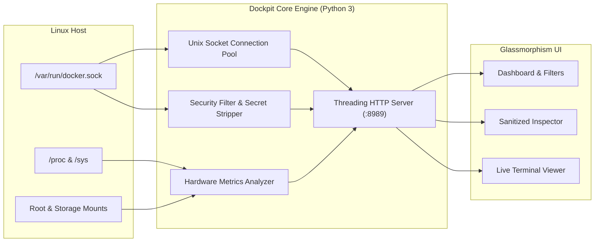

<div align="center">


<br/><br/>

[](LICENSE)
[](https://www.python.org/)
[](pyproject.toml)
[](docker-compose.yml)
[](.github/workflows/ci.yml)

<p align="center">
  <strong>A blazing fast, ultra-lightweight, real-time Docker container cockpit &amp; host monitor.</strong><br/>
  Zero external dependencies. Normalized 0–100% host CPU. Stack-first visualization. Hardened server-side secret stripping.
</p>

[Key Features](#-key-features) •
[Quickstart](#-quickstart) •
[Architecture](#-architecture) •
[Security & Hardening](#-security--hardening) •
[Configuration](#-configuration) •
[API Reference](#-api-reference) •
[Documentation](#-documentation)

</div>

---

## 📸 Dashboard Preview

<div align="center">
  
</div>

---

## ✨ Key Features

- **🚀 Zero External Dependencies:** Built purely on Python 3 standard library (`http.server`, `socket.AF_UNIX`, `concurrent.futures`, `shutil`). No Flask, Django, Node.js runtime, or bulky wheels. Runs everywhere with a tiny **~15 MB memory footprint** and negligible CPU overhead.
- **🔍 Interactive Hardware & Storage Modals:** Click on any of the 4 top status cards (CPU, RAM, Storage, Containers) to inspect comprehensive hardware details:
  - **CPU:** Hardware model, vendor, frequency (MHz), L1-L3 cache sizes, core/thread topology, flags, and real-time load averages.
  - **RAM:** Full memory distribution (Active RSS, purgeable page cache, slab, shared memory, swap utilization).
  - **Storage:** Complete physical block device inventory (`/dev/nvme*`, `/dev/sd*`), hardware serial numbers, persistent Disk IDs (`by-id` with one-click copy), partition maps, filesystem types, and live mount usage.
  - **System & Runtime:** Linux kernel version, OS distribution, host uptime, Docker Engine, containerd/runc versions, and fleet health.
- **📊 Normalized 0–100% Host CPU:** Solves the multi-core Docker CLI confusion where multi-threaded containers report misleading numbers like `600%` or `1200%`. Dockpit computes real, normalized host utilization across all CPU cores.
- **💾 True Resident Memory (RSS):** Docker stats often include reclaimable Linux page buffers / file cache, making containers look falsely starved for RAM. Dockpit accurately isolates active memory from inactive cache:
  $$\text{Used Memory} = \max(0, \text{usage} - \text{inactive\_file})$$
- **🧩 Stack-First Visual Grouping:** Organizes your entire Docker universe into collapsible Compose projects (`com.docker.compose.project`), complete with aggregate CPU, RAM consumption, and health indicators.
- **🔒 Hardened Server-Side Secret Stripping:** When inspecting containers, Dockpit strips all environment variables (`Env`) and credentials server-side before delivering JSON to the browser. Tokens, database passwords, and API keys are **never** transmitted over the wire.
- **⚡ Real-Time Unix Socket Streaming:** Reads directly from `/var/run/docker.sock` via Unix domain socket HTTP connection pools with automatic subprocess fallback.
- **🔎 Instant Fuzzy Search & Quick Filters:** Live filtering across container names, services, image tags, published ports, and storage tiers (Root vs Secondary storage).
- **📋 Live Container Logs & Safe Inspection:** Tail live container logs (stdout/stderr) with bounded payloads (max 1 MB / 500 lines) and one-click clipboard copying.
- **🛡️ Injection-Proof API:** Strictly sanitizes container names against alphanumeric whitelist regex and active memory tables. Flags like `--help` or shell escapes are safely rejected with HTTP 400.

---

## ⚡ Quickstart

### Option 1: Docker Compose (Recommended)

Clone the repository and spin up Dockpit in seconds:

```bash
git clone https://github.com/Elounia/dockpit.git
cd dockpit
docker compose up -d
```

Access the dashboard at **`http://localhost:8989`** (or your server's IP address).

### Option 2: Docker CLI

```bash
docker run -d \
  --name dockpit \
  --restart unless-stopped \
  -p 127.0.0.1:8989:8989 \
  -v /var/run/docker.sock:/var/run/docker.sock:ro \
  -v /proc:/host/proc:ro \
  -v /sys:/host/sys:ro \
  -v /:/host/root:ro \
  --read-only \
  --cap-drop ALL \
  --security-opt no-new-privileges:true \
  dockpit:latest
```

### Option 3: Standalone Python (No Docker Required for Host)

Dockpit has **zero third-party dependencies**. Run it directly with Python 3.9+:

```bash
git clone https://github.com/Elounia/dockpit.git
cd dockpit

# Launch directly (binds to 127.0.0.1 by default)
./bin/dockpit
# or: python3 -m dockpit
```

Open `http://localhost:8989`.

---

## 🔒 Remote Access: Tailscale (Recommended) & Authelia SSO

Dockpit is configured out-of-the-box with **strict localhost isolation** (`127.0.0.1:8989`). Docker management tools should **never** be exposed unauthenticated to the public internet.

### 🥇 Recommended Baseline: Tailscale (Private Mesh VPN)
For personal, home lab, and team server administration, the **recommended default approach is to use Tailscale** (or WireGuard / Headscale):
- **Zero Open Internet Ports:** Dockpit remains strictly bound to `127.0.0.1` or your private Tailscale IP (`100.x.y.z`), requiring no port-forwarding on your router or cloud firewall.
- **Identity-Based Authentication:** Access is governed by your Tailscale tailnet SSO (Google, GitHub, Microsoft, Okta) with built-in multi-factor authentication (MFA).
- **Automatic HTTPS with MagicDNS:** Use `tailscale serve` to instantly get valid Let's Encrypt HTTPS certificates for `https://dockpit.<your-tailnet>.ts.net` without exposing any public web servers.

### 🥈 Alternative: Authelia Single Sign-On (Forward-Auth)
If you require browser access under a public domain (e.g. `https://dockpit.yourdomain.com`) without installing VPN software on client devices:
- **Isolated Admin Network:** Dockpit runs on an internal Docker bridge network (`dockpit_admin`) without publishing ports to the host.
- **Forward-Auth Verification:** Nginx / Traefik / Caddy intercepts incoming requests and validates identity via Authelia's auth verification endpoint.
- **Enforced 2FA & RBAC:** Unauthenticated users are redirected to your Authelia 2FA portal (TOTP / WebAuthn security keys), restricting dashboard access to authorized admin groups (`group:admins`).

👉 **Read the complete guide for both Tailscale and Authelia setups in [docs/AUTHELIA_SSO.md](docs/AUTHELIA_SSO.md).**

---

## 📐 Architecture

Dockpit bridges the Docker Unix Domain Socket and the host's `/proc` filesystem directly into an ultra-fast, reactive browser client:



For comprehensive technical insights, read [ARCHITECTURE.md](docs/ARCHITECTURE.md).

---

## 🛡️ Security & Hardening

Dockpit is built for production environments and home labs alike:

| Security Measure | Implementation |
|---|---|
| **Secret Stripping** | Environment variables (`Env`) containing passwords, tokens, and keys are removed server-side before returning inspect data. |
| **Input Validation** | Container identifiers must match `^[a-zA-Z0-9_\.\-]+$` and be present in active memory. Injection flags (e.g. `--help`, command chaining) are rejected. |
| **Bounded Payloads** | Log streams are capped at 500 lines and truncated to 1 MiB to avoid memory exhaustion attacks. |
| **Rootless Container** | Container runs under UID 1000 (`dockpit:dockpit`), drops all capabilities (`cap_drop: ALL`), and mounts a `read_only` root filesystem. |
| **Reverse Proxy Ready** | Works seamlessly behind Authelia, Authentik, Caddy, Traefik, Nginx, or Cloudflare Tunnels. |

---

## ⚙️ Configuration

Configure Dockpit using environment variables:

| Variable | Default | Description |
|---|---|---|
| `DOCKPIT_PORT` | `8989` | Port to bind the web dashboard and REST API |
| `DOCKPIT_HOST` | `127.0.0.1` | Host interface to listen on (`127.0.0.1` for local-only, `0.0.0.0` within isolated networks) |
| `DOCKPIT_DOCKER_SOCKET` | `/var/run/docker.sock` | Path to the Docker Unix domain socket |
| `DOCKPIT_POLL_INTERVAL` | `2.0` | Background metrics poll interval in seconds |
| `DOCKPIT_PROC_DIR` | `/host/proc` or `/proc` | Path to host procfs |
| `DOCKPIT_ROOT_DIR` | `/host/root` or `/` | Path to host root filesystem |
| `DOCKPIT_SECONDARY_STORAGE_PATH` | *auto-detected* | Custom path to secondary storage mount (e.g. `/mnt/data`) |
| `DOCKPIT_SECONDARY_STORAGE_LABEL` | `"Data Storage"` | Friendly display label for secondary storage disk |

---

## 📡 API Reference

Dockpit includes a clean, read-only REST API:

- **`GET /api/stats`**: Full JSON snapshot of all Docker stacks, containers, host CPU/RAM, and storage tiers.
- **`GET /api/inspect?name=<container>`**: Safe runtime container inspection with secrets stripped.
- **`GET /api/logs?name=<container>&tail=100`**: Live bounded stdout/stderr log stream.

Full API documentation and response schemas are detailed in [API.md](docs/API.md).

---

## 📚 Documentation

- [Architecture & Design Details](docs/ARCHITECTURE.md)
- [Securing with Authelia SSO & Reverse Proxy](docs/AUTHELIA_SSO.md)
- [Deployment Guide (Docker, Compose, Proxies, Systemd)](docs/DOCKER.md)
- [REST API Specifications](docs/API.md)
- [Contributing Guidelines](CONTRIBUTING.md)

---

## 🧪 Testing

Dockpit features 100% standard library test suites. Run tests with:

```bash
python3 -m unittest discover -s tests -v
```

---

## 📄 License & Author

**Dockpit** is open-source software authored by **Carl-Emil Berg** and licensed under the **[MIT License](LICENSE)**.

