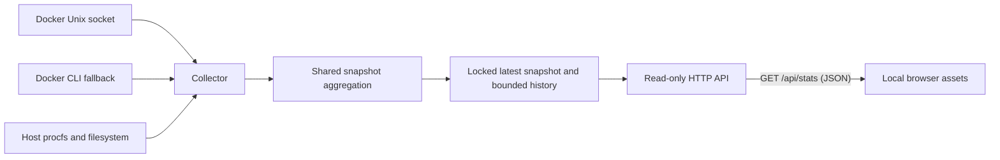

# Architecture

Dockpit uses the Python standard library for its server and collectors. HTML, JavaScript, compiled Tailwind CSS and licensed Font Awesome assets live in `dockpit/static` and are included in the wheel and image.

A background worker polls Docker. The Unix socket backend requests the full inventory and gathers running stats with at most 16 workers. Stopped containers are included without issuing stats requests. CPU deltas are cached between samples. Both socket and CLI backends use `aggregate_snapshot`, so startup and rendering do not depend on a backend-specific schema. Tests select dependencies explicitly; production code does not detect mocks.

Failures preserve the previous snapshot and update Diagnostics. The worker continues polling. Measurement timestamps, availability and readiness expose stale or missing data. The next successful poll clears the error. Host metrics use procfs/statvfs; missing measurements do not fall back to fabricated host capacities.

The frontend escapes external strings at HTML render boundaries and uses delegated actions instead of inline JavaScript attributes. Logs and diagnostics are assigned with `textContent`. Original API data remains available for search and preferences. A local-only script CSP and no wildcard CORS reduce browser attack surface.

Container inspection uses an allowlist. Environment variables, command arguments and healthcheck output are not sent to the browser. Logs remain raw application data and can contain secrets. The log reader handles TTY text and Docker's multiplexed stream separately, bounding bytes during reading. CLI log reading is also bounded and time limited.

There is no authentication layer or Docker authorization boundary inside Dockpit. Read-only HTTP methods do not remove the process's Docker socket authority. See [SECURITY.md](../SECURITY.md).

Container memory uses `Used Memory = max(0, usage - inactive_file)` (or `total_inactive_file` on cgroup v1). This is cache-adjusted usage, not an exact measurement of process RSS.
