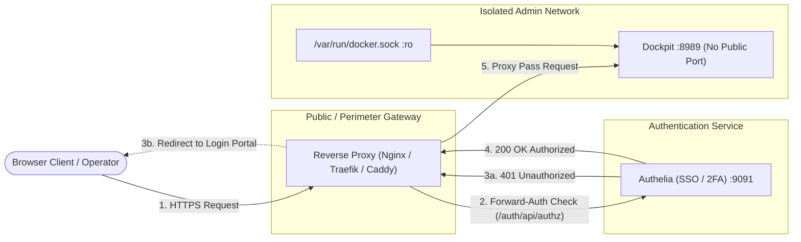

# Securing Dockpit Remote Access: Tailscale & Authelia SSO

Run Compose examples from the repository root. Before starting, set `export DOCKER_GID="$(stat -c '%g' /var/run/docker.sock)"`.

By default, Dockpit binds strictly to **`127.0.0.1:8989`** (localhost only). Because Dockpit interfaces with `/var/run/docker.sock` and the host operating system, it should **never** be exposed unauthenticated to the public internet or an untrusted local network.

This guide covers the two standard, hardened approaches for accessing your Dockpit instance remotely:
1. **🥇 Recommended Baseline: Tailscale (Private Mesh VPN / MagicDNS)** — Zero open public ports, native SSO/MFA, and automated Let's Encrypt certificates.
2. **🥈 Alternative: Reverse Proxy + Authelia Single Sign-On (Forward-Auth)** — For clientless browser access via a public domain name with 2FA gating.

---

## 🥇 Recommended Baseline: Tailscale Private Mesh VPN

A private VPN such as Tailscale, Headscale or WireGuard can provide remote access without publishing the dashboard to the public internet.

### Why Tailscale is the Recommended Default:
- **Zero Exposed Ports:** Your server needs no port forwarding on your router, no NAT traversal holes, and no public DNS records pointing to your IP.
- **Hardware-Level and Identity-Level Authentication:** Access is restricted to devices authenticated into your private "tailnet" via your identity provider (Google, GitHub, Microsoft, Okta) ; enable MFA and configure access policy in your identity provider.
- **End-to-End Encryption:** All traffic between your client laptop/phone and the host running Dockpit is encrypted via WireGuard.

### Method A: Serve via Tailscale HTTPS (One Command)
If Tailscale is installed on the host running Dockpit:
```bash
# Point Tailscale Serve to your local Dockpit instance
tailscale serve --bg 8989
```
Tailscale automatically provisions a valid Let's Encrypt TLS certificate for your machine's MagicDNS name. You can now securely visit:
```
https://<hostname>.<your-tailnet>.ts.net
```
from any authenticated machine or mobile device in your Tailscale network!

### Method B: Bind Dockpit Directly to Your Tailscale IP
If you run Dockpit as a systemd service or binary, bind it exclusively to your machine's `100.x.y.z` interface:
```bash
# Find your Tailscale IPv4 address
TAILSCALE_IP=$(tailscale ip -4)

# Launch Dockpit bound only to Tailscale
DOCKPIT_HOST="$TAILSCALE_IP" DOCKPIT_PORT=8989 dockpit
```
Only devices connected to your private Tailscale network will be able to connect; all other local and public network traffic is ignored.

---

## 🥈 Alternative: Authelia Single Sign-On (SSO) & Reverse Proxy

If you need users or team members to access Dockpit from arbitrary browsers **without** requiring them to install Tailscale client software, place Dockpit behind a reverse proxy (Nginx, Traefik, or Caddy) guarded by **Authelia forward authentication**.

---

## 🏗️ Architecture Overview



### Security Benefits of this Setup
1. **No Direct Port Exposure:** Dockpit does not expose port 8989 to the internet. It lives only on an internal Docker bridge network (`dockpit_admin`) or binds to `127.0.0.1`.
2. **Mandatory 2FA:** Access is gated by Authelia's two-factor authentication (TOTP or WebAuthn/FIDO2 security keys).
3. **RBAC & Groups:** Only users in designated admin groups (e.g. `group:admins`) can reach the cockpit.
4. **Header Sanitization:** Sensitive headers are stripped or controlled by the reverse proxy.

---

## 🚀 Complete Docker Compose Setup

Here is an end-to-end `docker-compose.yml` running Dockpit, Nginx, and Authelia on an isolated internal network:

```yaml
services:
  # 1. Reverse Proxy Gateway
  gateway:
    image: nginx:alpine
    container_name: dockpit_gateway
    restart: unless-stopped
    ports:
      - "80:80"
      - "443:443"
    volumes:
      - ./nginx.conf:/etc/nginx/nginx.conf:ro
      - ./certs:/etc/nginx/certs:ro
    networks:
      - dockpit_admin

  # 2. Authelia SSO Service
  authelia:
    image: authelia/authelia:latest
    container_name: dockpit_authelia
    restart: unless-stopped
    volumes:
      - ./authelia/configuration.yml:/config/configuration.yml:ro
      - ./authelia/users_database.yml:/config/users_database.yml:ro
    environment:
      - TZ=UTC
    networks:
      - dockpit_admin

  # 3. Dockpit Dashboard (Isolated)
  dockpit:
    build: .
    image: dockpit:local
    container_name: dockpit
    restart: unless-stopped
    # NOTICE: No 'ports' section! Dockpit is only reachable by the gateway on the internal network.
    environment:
      - PYTHONUNBUFFERED=1
      - DOCKPIT_PORT=8989
      - DOCKPIT_HOST=0.0.0.0 # Accessible to gateway within dockpit_admin network
    volumes:
      - /var/run/docker.sock:/var/run/docker.sock:ro
      - /proc:/host/proc:ro
      - /sys:/host/sys:ro
      - /:/host/root:ro
    group_add:
      - "${DOCKER_GID:?Set DOCKER_GID from the Docker socket group}"
    read_only: true
    cap_drop:
      - ALL
    security_opt:
      - no-new-privileges:true
    tmpfs:
      - /tmp
    networks:
      - dockpit_admin

networks:
  dockpit_admin:
    name: dockpit_admin
    driver: bridge
```

---

## 🔒 Nginx Forward-Auth Configuration

Save the following as `nginx.conf`:

```nginx
events { worker_connections 1024; }

http {
    include       /etc/nginx/mime.types;
    default_type  application/octet-stream;
    sendfile      on;

    # Map WebSocket upgrades
    map $http_upgrade $connection_upgrade {
        default upgrade;
        ''      close;
    }

    server {
        listen 443 ssl http2;
        server_name dockpit.yourdomain.com;

        ssl_certificate     /etc/nginx/certs/fullchain.pem;
        ssl_certificate_key /etc/nginx/certs/privkey.pem;

        # Hardened Security Headers
        add_header Strict-Transport-Security "max-age=31536000; includeSubDomains" always;
        add_header X-Content-Type-Options nosniff always;
        add_header Referrer-Policy same-origin always;

        # Upstream service pointers
        set $authelia_backend http://authelia:9091;
        set $dockpit_backend  http://dockpit:8989;

        # -------------------------------------------------------------
        # 1. Authelia Authentication Endpoints
        # -------------------------------------------------------------
        location = /auth { return 302 /auth/; }

        location ^~ /auth/ {
            proxy_pass $authelia_backend$request_uri;
            proxy_set_header Host $host;
            proxy_set_header X-Real-IP $remote_addr;
            proxy_set_header X-Forwarded-For $proxy_add_x_forwarded_for;
            proxy_set_header X-Forwarded-Proto $scheme;
            proxy_set_header X-Forwarded-Host $host;
        }

        # Internal auth verification sub-request
        location = /internal/authelia/authz {
            internal;
            proxy_pass $authelia_backend/auth/api/authz/auth-request;
            proxy_set_header Host $host;
            proxy_set_header X-Original-Method $request_method;
            proxy_set_header X-Original-URL $scheme://$host$request_uri;
            proxy_set_header X-Forwarded-For $remote_addr;
            proxy_set_header Content-Length "";
            proxy_set_header Connection "";
            proxy_pass_request_body off;
        }

        # -------------------------------------------------------------
        # 2. Dockpit Application (Protected by Authelia)
        # -------------------------------------------------------------
        location / {
            # Check authentication with Authelia before forwarding
            auth_request /internal/authelia/authz;

            # If unauthenticated, redirect to Authelia portal
            auth_request_set $auth_redirect $upstream_http_location;
            error_page 401 =302 $auth_redirect;

            # Proxy to internal Dockpit service
            proxy_pass $dockpit_backend$request_uri;

            # Reverse proxy headers
            proxy_http_version 1.1;
            proxy_set_header Host $host;
            proxy_set_header X-Real-IP $remote_addr;
            proxy_set_header X-Forwarded-For $proxy_add_x_forwarded_for;
            proxy_set_header X-Forwarded-Proto $scheme;
            proxy_set_header Upgrade $http_upgrade;
            proxy_set_header Connection $connection_upgrade;

            # Strip external authorization to prevent credential reflection
            proxy_set_header Authorization "";

            proxy_read_timeout 300s;
            proxy_send_timeout 300s;
        }
    }

    # Redirect all plain HTTP to HTTPS
    server {
        listen 80;
        server_name dockpit.yourdomain.com;
        return 308 https://$host$request_uri;
    }
}
```

---

## ⚙️ Authelia Configuration (`configuration.yml`)

Configure Authelia's access control rules to require two-factor authentication for your Dockpit domain:

```yaml
server:
  host: 0.0.0.0
  port: 9091

access_control:
  default_policy: deny
  rules:
    # Allow public access to the Authelia portal itself
    - domain: "auth.yourdomain.com"
      policy: bypass

    # Require Two-Factor Authentication (2FA) for Dockpit
    - domain: "dockpit.yourdomain.com"
      policy: two_factor
      subject:
        - "group:admins"
```

---

## 🔀 Alternative: Traefik ForwardAuth Middleware

If using **Traefik**, attach the forward-auth middleware to the Dockpit router:

```yaml
http:
  middlewares:
    authelia-auth:
      forwardAuth:
        address: "http://authelia:9091/api/authz/forward-auth"
        trustForwardHeader: true
        authResponseHeaders:
          - "Remote-User"
          - "Remote-Groups"
          - "Remote-Name"
          - "Remote-Email"

  routers:
    dockpit:
      rule: "Host(`dockpit.yourdomain.com`)"
      entryPoints: ["websecure"]
      service: "dockpit"
      middlewares: ["authelia-auth"]
      tls:
        certResolver: "letsencrypt"

  services:
    dockpit:
      loadBalancer:
        servers:
          - url: "http://dockpit:8989"
```

---

## 🌐 Alternative: Caddy Forward-Auth

If using **Caddy v2**, use the `forward_auth` directive:

```caddy
dockpit.yourdomain.com {
    # Verify authentication with Authelia
    forward_auth http://authelia:9091 {
        uri /api/authz/forward-auth
        copy_headers Remote-User Remote-Groups Remote-Email
    }

    # Reverse proxy to Dockpit
    reverse_proxy 127.0.0.1:8989
}
```

---

## 📋 Checklist for Production Deployment

- [x] Host binding strictly set to `127.0.0.1:8989` or isolated within a Docker bridge network.
- [x] TLS / SSL certificate installed on perimeter reverse proxy with HTTPS redirection.
- [x] Authelia access control policy set to `two_factor` for the Dockpit domain.
- [x] Docker socket authority understood: `:ro` does not restrict Docker API methods.
- [x] Dockpit process running as a non-root user (`dockpit:dockpit`, UID 1000) with `read_only: true` and `cap_drop: ALL`.

